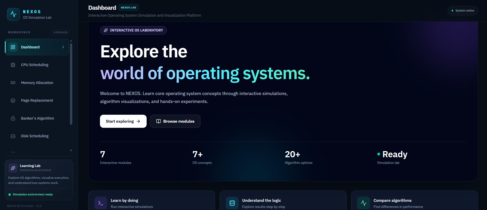
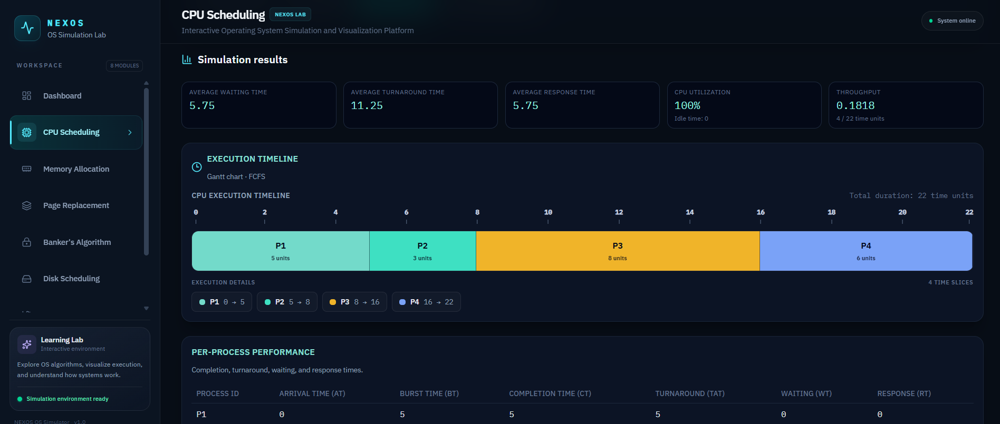
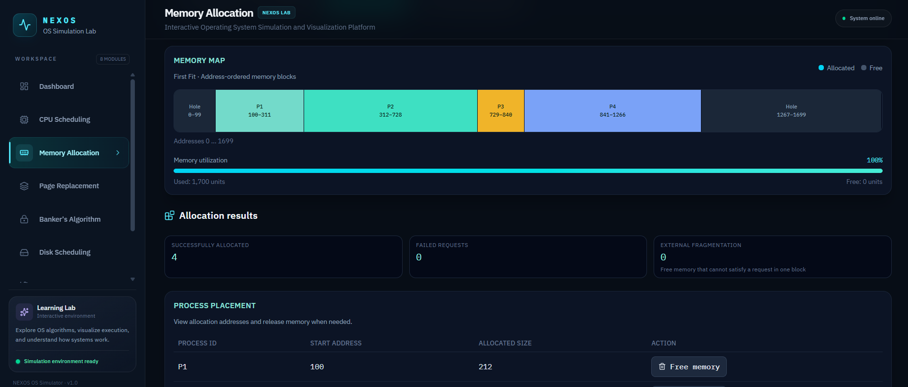
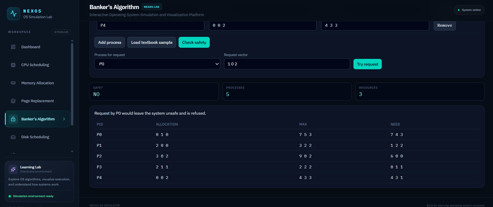
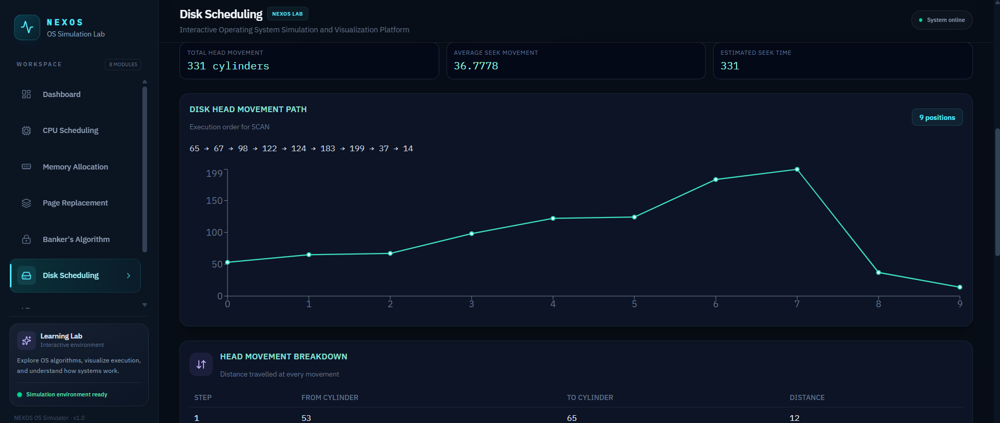
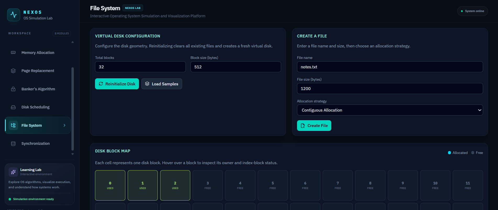
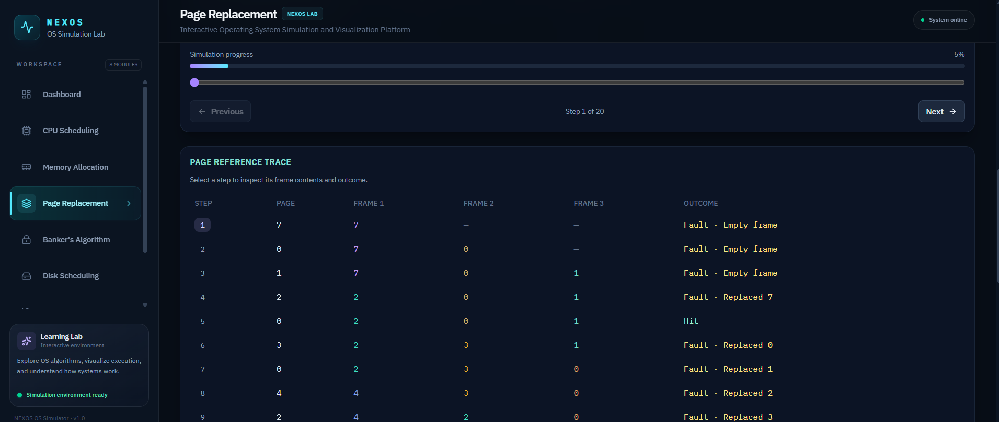

# 🚀 NEXOS — Operating System Simulator

An interactive web-based Operating System Simulator designed to make operating system concepts easier to understand through a modern user interface.

**🌐 Live Website**  
[Open NEXOS OS Simulator](https://nexos-os-simulator.vercel.app/)

## 1. 💻 Business Problem

Operating Systems are a fundamental part of computer science, but understanding their internal working can be challenging for students. Concepts such as process management, CPU scheduling, memory management, and resource allocation can be difficult to visualize through theoretical explanations alone.

Traditional learning methods often lack interactive demonstrations, making it harder for students to understand how an operating system manages processes and system resources.

## 2. 💡 Possible Solution

An interactive Operating System Simulator can help students understand OS concepts through visual demonstrations and practical learning.

The solution should aim to:

- Provide an interactive interface for learning OS concepts.
- Visualize operating system operations.
- Make theoretical concepts easier to understand.
- Offer browser-based access without requiring a separate desktop application.
- Provide a simple and user-friendly learning experience.

## 3. 🚀 Implemented Solution

NEXOS is a web-based Operating System Simulator developed to provide an interactive learning environment for operating system concepts.

The application uses a modern web interface to help users explore the functionality implemented in the simulator.

**Key components:**

- **User Interface** → Provides access to the simulator features.
- **Simulation Interface** → Presents the operating system operations supported by the project.
- **Interactive Components** → Allow users to interact with the available simulations.
- **Web Application** → Makes the simulator accessible through a browser.

**🔄 Workflow:**

1. User opens the NEXOS website.
2. User navigates through the available simulator features.
3. User interacts with the supported OS operations.
4. The application displays the corresponding interface and simulation results.

*Note: Include specific algorithms and features here only if they are implemented in your actual project.*

## 4. 🛠️ Tech Stack Used

| Component | Technology |
|---|---|
| Frontend | React |
| Programming Language | JavaScript |
| Build Tool | Vite |
| Markup | HTML5 |
| Styling | CSS3 |
| Version Control | Git and GitHub |
| Deployment | Vercel |

## 5. 🧩 Architecture Diagram

**Architecture Flow:**

```text
User
  ↓
Web Browser
  ↓
NEXOS User Interface
  ↓
React Components
  ↓
Operating System Simulation Logic
  ↓
Results Displayed in the Interface
```

## 6. ▶️ How to Run Locally

🔹 **Step 1: Install Prerequisites**

Install Node.js and npm on your computer.

🔹 **Step 2: Clone the Repository**

```bash
git clone https://github.com/Manasvi-chennupati/NEXOS-OS-Simulator---Operating-Systems.git
```

🔹 **Step 3: Navigate to the Project Folder**

```bash
cd NEXOS-OS-Simulator---Operating-Systems
```

🔹 **Step 4: Install Dependencies**

```bash
npm install
```

🔹 **Step 5: Run the Application**

```bash
npm run dev
```

🔹 **Step 6: Open in Browser**

Open the local URL displayed in your terminal, usually:

`http://localhost:5173`

## 7. 📚 References & Resources

- React: https://react.dev/
- Vite: https://vite.dev/
- MDN Web Docs: https://developer.mozilla.org/
- Node.js: https://nodejs.org/
- Vercel: https://vercel.com/docs

## 8. 📸 Screenshots

### 🏠 Home Page


### ⚙️ CPU Scheduling


### 🧠 Memory Allocation


### 🔒 Banker's Algorithm


### 💽 Disk Scheduling


### 📂 File System


### 📄 Page Replacement


## 9. 🎨 User Interface

NEXOS provides a browser-based interface for interacting with the operating system simulator.

The interface is intended to make navigation simple and help users explore the available features in an organized way.

Add actual screenshots to highlight:

- Home page and navigation.
- Available simulation modules.
- Input controls and simulation results.
- Responsive layout, if supported.

## 10. 📐 Formatting

✔ Clear headings and structured sections.  
✔ Bullet points for improved readability.  
✔ Tables for technology details.  
✔ Code blocks for installation and execution commands.  
✔ Architecture flow for explaining the application.  
✔ Screenshot section for visual demonstration.

## 11. ⚠️ Problems Encountered and Solutions

Developing a web-based simulator can involve challenges related to component organization, user interactions, application layout, and deployment.

Potential areas to document include:

- **Component Management:** Organizing React components to keep the interface maintainable.
- **User Interaction:** Ensuring controls respond correctly to user actions.
- **Responsive Design:** Making the interface usable across different screen sizes.
- **Build Configuration:** Resolving dependency or production-build issues.
- **Deployment:** Configuring Vercel to build and publish the application from GitHub.

---

**NEXOS — Making Operating Systems more interactive.** 🚀
